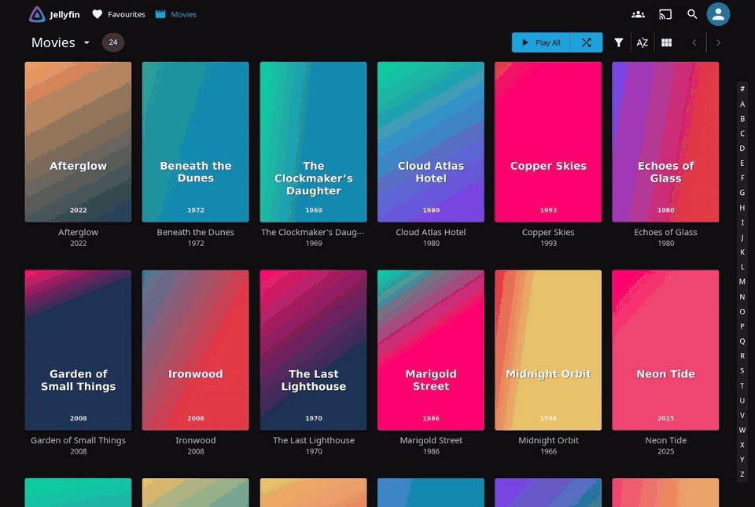
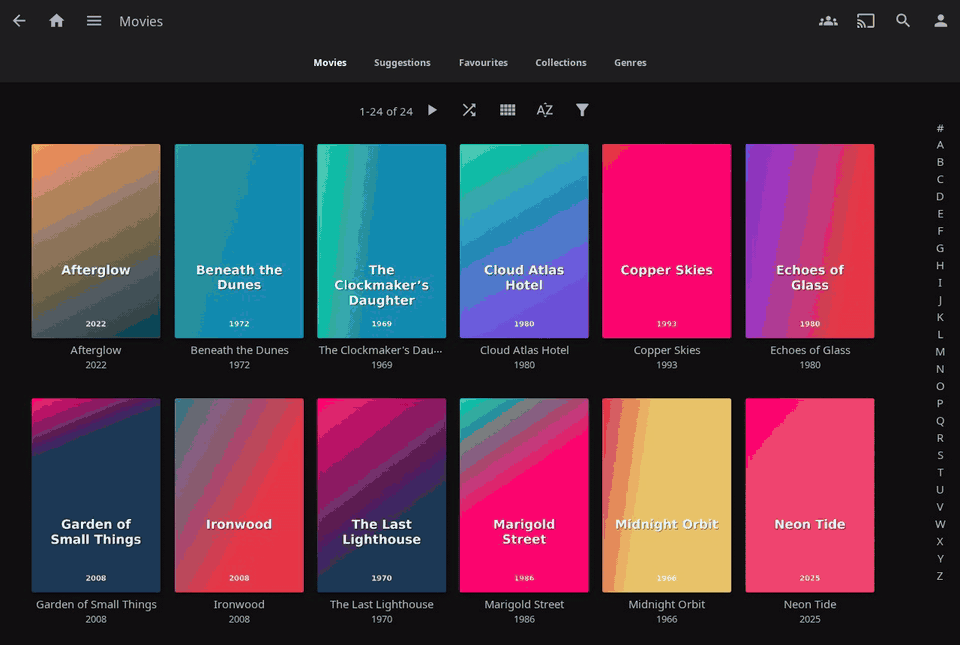

<p align="center">
  
</p>

<h1 align="center">Jellyfin Filter Search Plugin</h1>

<p align="center">
  A Jellyfin plugin that adds search functionality to filter dialogs and displays enabled filters at the top.
</p>

<p align="center">
  
</p>

---

## ⚠️ IMPORTANT: Required Setup After Installation

> **This plugin needs write access to `index.html` to inject JavaScript into the Jellyfin web interface.**
>
> After installing the plugin, you **must** run one of the following commands depending on your setup:

### 🐧 Linux (Native Installation)
```bash
sudo chown jellyfin:jellyfin /usr/share/jellyfin/web/index.html
sudo systemctl restart jellyfin
```

### 🐳 Docker
**Option A:** Install the [File Transformation Plugin](https://github.com/IAmParadox27/jellyfin-plugin-file-transformation) (recommended)

**Option B:** Map `index.html` as a volume:
```bash
# Copy index.html from container
docker cp jellyfin:/usr/share/jellyfin/web/index.html /path/to/config/index.html

# Add to your docker-compose.yml volumes:
- /path/to/config/index.html:/usr/share/jellyfin/web/index.html
```

### 🪟 Windows
The plugin should work without additional setup on Windows.

> **Note:** The `chown` command may need to be re-run after Jellyfin updates, as the update process may reset file ownership.

---

## Features

- **Search through filter options** – Quickly find tags, genres, studios, years, and more
- **Selected filters at top** – Enabled/checked filters are automatically shown at the top
- **Select All / None** – Check or uncheck every option that matches the current search in one click
- **Sticky search bar** – The search input stays visible while scrolling
- **Modern and Legacy layouts** – Works in the Jellyfin 12 modern web UI and in the "Legacy Desktop" display mode

## Compatibility

| Jellyfin version | Plugin version | Layouts |
|------------------|----------------|---------|
| 12.2.x           | 1.9.0.0        | Modern and Legacy |
| 10.11.x          | 1.8.0.0        | Legacy |
| 10.10.x          | 1.7.0.0        | Legacy |

## Demo

**Modern layout (Jellyfin 12 default)**


**Legacy Desktop layout**



## Installation

1. Go to **Dashboard** → **Plugins** → **Repositories**
2. Add the Filter Search repository:
   ```
   https://raw.githubusercontent.com/rimseg/jellyfin-filter-search/main/manifest.json
   ```
3. Go to **Catalog** and install **Filter Search**
4. Restart Jellyfin
5. **⚠️ Follow the [Required Setup](#️-important-required-setup-after-installation) above!**

## Configuration

After installation, go to **Dashboard** → **Plugins** → **Filter Search** to enable/disable the plugin.

## Usage

1. Go to any library (Movies, TV Shows, etc.)
2. Click the **Filter** button (the funnel icon in the library toolbar)
3. Expand a filter section (Tags, Genres, Studios, etc.)
4. A search bar will appear at the top of the section (for sections with 5 or more options)
5. Selected filters are automatically shown at the top with a "Selected" label
6. Use **Select All** / **None** to toggle every option that matches the current search

## Building from Source

### Prerequisites

- .NET 10 SDK (for Jellyfin 12.x), .NET 9 SDK (for Jellyfin 10.11.x) or .NET 8 SDK (for Jellyfin 10.10.x)

### Build

```bash
cd Jellyfin.Plugin.FilterSearch
dotnet build -c Release
```

The built plugin will be in `bin/Release/net10.0/` (or `net9.0` / `net8.0` for older Jellyfin versions).

### Install Manually

Copy `Jellyfin.Plugin.FilterSearch.dll` to your Jellyfin plugins directory:
- **Linux:** `/var/lib/jellyfin/plugins/FilterSearch/` (Debian/Ubuntu packages) or `~/.local/share/jellyfin/plugins/FilterSearch/`
- **Windows:** `%APPDATA%\Jellyfin\Server\plugins\FilterSearch\`
- **Docker:** `/config/plugins/FilterSearch/`

Then restart Jellyfin.

### Building for Different Jellyfin Versions

Edit the `JellyfinVersion` property in `Jellyfin.Plugin.FilterSearch.csproj`:

```xml
<!-- For Jellyfin 10.10.x -->
<JellyfinVersion>10.10.7</JellyfinVersion>

<!-- For Jellyfin 10.11.x -->
<JellyfinVersion>10.11.8</JellyfinVersion>

<!-- For Jellyfin 12.x -->
<JellyfinVersion>12.2.0</JellyfinVersion>
```

## Notes

- Version 1.9.0.0 and later target Jellyfin 12.x and support both the modern layout and the "Legacy Desktop" display mode
- For Jellyfin 10.10.x / 10.11.x use the older releases listed under [Compatibility](#compatibility)

## Credits

- [Jellyfin-Javascript-Injector](https://github.com/n00bcodr/Jellyfin-JavaScript-Injector/)

## License

MIT License